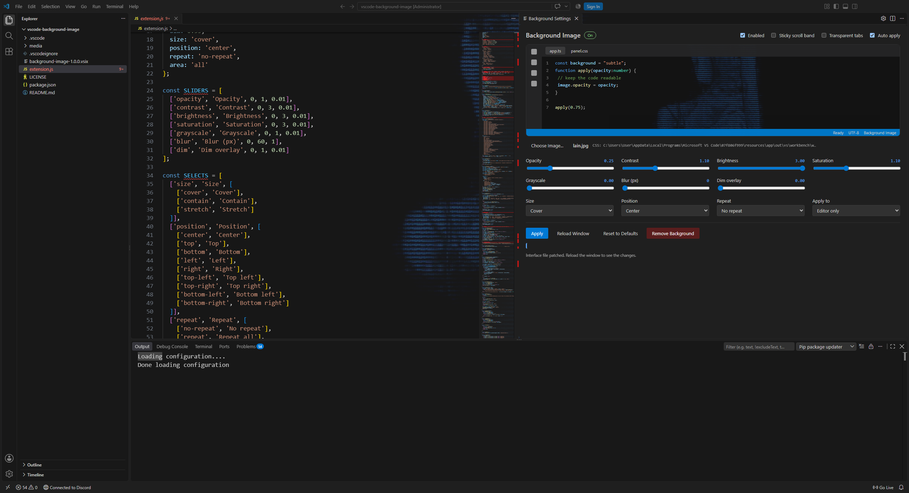

# Background Image

Set any photo or wallpaper as your VS Code background no settings files, no JSON, no
guessing what a value like `0.75` looks like.

I built this because every background extension I tried made me hand-edit `settings.json`
and then guess why nothing showed up. This one gives you a panel with live sliders, so
you see the result before anything is written to disk.



---

## Installation

1. Download `background-image-1.0.0.vsix` from the
   [latest release](https://github.com/enesrameds/vscode-background-image/releases/latest).
   It's about 22 KB.
2. In VS Code press `Ctrl+Shift+P`, type **Install from VSIX...** and pick the file.

   Prefer the terminal? This does the same thing:

   ```bash
   code --install-extension background-image-1.0.0.vsix
   ```

3. **Quit VS Code completely and open it again.** Just once, right after installing —
   there's a note about why below.

## Using it

Press `Ctrl+Shift+P` and run **Background: Background Image Settings**.

That opens the panel. From there:

1. **Choose Image...** — a file picker opens, or just drag an image onto the panel.
2. Move the sliders. The little preview in the panel updates as you drag.
3. Press **Apply**, then **Reload Window**.

Done. If you switch on *Auto apply*, the background updates itself whenever you change
anything and you can skip the Apply button.

Don't like it? Run **Background: Remove Background** and everything goes back to exactly
how it was.

---

## What you can control

- **Opacity, brightness, contrast, saturation, grayscale, blur** — the usual suspects,
  all on sliders.
- **Dim** — a dark veil over the image so your text stays readable. This one matters more
  than you'd expect.
- **Size** — cover, contain or stretch.
- **Position** — nine anchors (center, top-left, bottom-right, …).
- **Repeat** — off by default, since tiling a photo rarely looks good.
- **Scope** — the whole interface, or just the editor area behind your code. Editor-only
  is the subtle one; the rest of the UI keeps its own background.
- **Sticky scroll band and tab fills** — two checkboxes to get rid of the opaque strips
  that otherwise cut across your wallpaper.

---

## Commands

| Command | What it does |
| --- | --- |
| `Background: Background Image Settings` | Opens the panel |
| `Background: Choose Image...` | Opens the file picker |
| `Background: Apply Background` | Writes the CSS file |
| `Background: Remove Background` | Undoes every change |
| `Background: Reset to Defaults` | Puts the visual settings back to their defaults |

## Settings

Everything lives under `background.*` in your settings, and the panel writes these for
you.

| Setting | Default | Notes |
| --- | --- | --- |
| `background.enabled` | `false` | Master switch |
| `background.image` | `""` | Path to the original image |
| `background.opacity` | `0.75` | 0–1 |
| `background.contrast` | `1.1` | 0–3 |
| `background.brightness` | `1` | 0–3 |
| `background.saturation` | `1.1` | 0–3 |
| `background.grayscale` | `0` | 0–1 |
| `background.blur` | `0` | Pixels, 0–60 |
| `background.dim` | `0.35` | Dark overlay, 0–1 |
| `background.size` | `cover` | `cover` / `contain` / `stretch` |
| `background.position` | `center` | `center`, `top`, `bottom-left`, … |
| `background.repeat` | `no-repeat` | `no-repeat`, `repeat`, `repeat-x`, `repeat-y` |
| `background.area` | `all` | `all` for the whole UI, `editor` for the editor only |
| `background.stickyScroll` | `true` | Set to `false` to hide the sticky scroll band |
| `background.transparentTabs` | `false` | Set to `true` to make tab fills see-through |
| `background.autoApply` | `true` | Apply as soon as a setting changes |

---

## How it works, and what to watch out for

To show an image behind the interface, an extension has no official API — so this one
appends a small, clearly marked CSS block to VS Code's own stylesheet
(`resources/app/out/vs/workbench/workbench.desktop.main.css`) and removes it again when
you uninstall or press **Remove Background**. Everything else follows from that:

- **You get a "Your Code installation appears to be corrupt" warning?** You shouldn't.
  The extension deletes the checksum entry for that file from `product.json` while the
  block is present, and writes it back when you remove the background. If you ever do see
  it, something interrupted the extension halfway — run **Remove Background** and it
  clears up.
- **The first apply needs write access.** If VS Code is installed under
  `C:\Program Files`, start it once as administrator, or install it to your user folder
  instead.
- **One full restart after installing.** VS Code's main process reads `product.json` into
  memory at startup, so the checksum entries are only refreshed after a real restart —
  not a window reload.
- **"Reload Window" is enough after that.** Chromium caches CSS aggressively, so the
  extension also stamps the stylesheet link in `workbench.html` with a `?v=<timestamp>`
  every time it writes. A plain reload always picks up the new background.
- **Keep the settings in your user settings, not the workspace.** If a project has
  `.vscode/settings.json` with `background.*` in it and you have two windows open, they
  will fight over the same file.
- **Your photo isn't embedded in the CSS.** It gets copied and downscaled into the
  extension's global storage, so a 3840×2160 wallpaper doesn't bloat the stylesheet.

## Building it from source

Clone the repo, open it in VS Code and press **F5** — that launches an Extension
Development Host with everything wired up. To make a distributable `.vsix`:

```bash
npx @vscode/vsce package
```

---

## License

[MIT](LICENSE). Issues and pull requests welcome.
